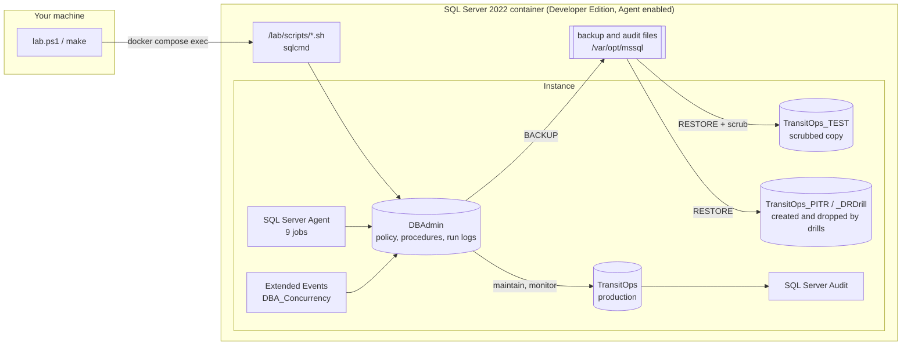

# TransitOps DBA Lab


A working database administration environment for a fictional metropolitan transit
agency, built to practise and demonstrate the day-to-day work of a Database
Administrator II on SQL Server, with an Oracle companion module.

One command builds a SQL Server 2022 instance, loads 1.5 million fare transactions,
then runs the jobs a DBA is actually paid for: backups that are proven by restoring
them, point-in-time recovery from a bad UPDATE, a disaster recovery drill measured
against RTO, six performance problems diagnosed and fixed with before and after
numbers, security hardening, partition archiving, and a schema change promoted
through TEST to production with a rehearsed rollback. A suite of assertions then
checks that every one of those things really happened.

Nothing in the results is typed by hand. The lab writes its own evidence report
from the log tables it filled while running.

## Results

Measured by the lab itself and written to [docs/evidence/lab-report.md](docs/evidence/lab-report.md).
The figures below are from the GitHub Actions run of 2026-11-16 on SQL Server 2022
(16.0.4325.4, CU28). Timings vary by host.

| Scenario | Result |
|---|---|
| Assertions | 44 of 44 passed |
| Backups | Every full, differential and log backup taken with CHECKSUM and verified; log chain with no gaps |
| Point-in-time recovery | Fleet-wide bad UPDATE undone: 4 backup files restored with STOPAT, 624 rows repaired and verified against the pre-incident checksum |
| DR drill | Full chain (6 backup files) restored in 6 s against a 3,600 s RTO; DBCC CHECKDB clean; row counts match production |
| Lab 1, missing index | 12,363 logical reads down to 32 (386x) |
| Lab 2, implicit conversion | 455 logical reads down to 6 (76x) |
| Lab 3, function on an indexed column | 6,607 logical reads down to 81 (82x) |
| Lab 4, parameter sniffing | 1,641,726 logical reads down to 6,607 (248x) |
| Lab 5, blocking | Reader wait of 10,027 ms down to 0 ms |
| Lab 6, deadlock | 1 deadlock captured with opposite lock order, 0 after the fix |
| Index maintenance | 6 partitions rebuilt online, fragmentation from 99 percent to 0.2 percent |
| Archiving | 252,714 rows moved to the archive by partition switch |
| Security | Every persona tested by impersonation, including masking, row-level security and the audit trail |

## What it covers

| DBA responsibility | Where | How it is proven |
|---|---|---|
| Install and configure | `docker-compose.yml`, `sqlserver/00_instance` | Instance baseline (memory, MAXDOP, cost threshold, backup defaults, DAC) and a version inventory |
| Backup and recovery | `sqlserver/10_dbadmin/120_backup.sql`, `130_restore.sql`, `sqlserver/40_backup_recovery` | Full, differential and log backups with CHECKSUM and VERIFYONLY; restore chain built from msdb history; policy compliance view |
| Point-in-time recovery | `sqlserver/40_backup_recovery/410` to `430` | An UPDATE without a WHERE clause is undone by restoring to a side database with STOPAT and repairing production, verified by checksum |
| Disaster recovery drills | `dba.usp_RestoreDrill`, `440_dr_drill.sql` | Full chain restored, DBCC CHECKDB on the copy, row counts compared, restore time logged against the RTO |
| Transaction log management | backup policy, health check | Log chain continuity test, VLF count, log space and log reuse wait checks |
| Data archiving | `fare.usp_ArchiveTapMonth`, `sqlserver/70_operations/700_sliding_window.sql` | A month of fare taps moved to the archive by partition switch, with row counts reconciled |
| Performance tuning | `sqlserver/50_performance`, [docs/performance-labs.md](docs/performance-labs.md) | Six labs: missing index, implicit conversion, non-sargable predicate, parameter sniffing, blocking, deadlock. Logical reads measured before and after by the engine |
| Monitoring | `sqlserver/10_dbadmin/150_monitoring.sql`, `170_extended_events.sql` | Health check over availability, recoverability, integrity, capacity, configuration, security and concurrency; blocking capture, deadlock capture with Extended Events, wait statistics deltas, Query Store |
| Index and storage management | `dba.usp_IndexMaintenance`, `usp_UpdateStatistics`, `usp_CaptureDatabaseSize` | Fragmentation-driven maintenance per partition with before and after figures; file size history |
| Security and access control | `sqlserver/30_security` | Role-based access for six personas, dynamic data masking, row-level security, SQL Server Audit. Tested by impersonating each persona |
| Developer support and code promotion | `sqlserver/60_change_management`, `scripts/migrate.sh` | Versioned migrations with checksums, applied to TEST first, rollback rehearsed, COPY_ONLY backup before production |
| Environment refresh | `dba.usp_RefreshLowerEnvironment` | TEST rebuilt from production backups with personal data scrubbed before anyone can query it |
| Scheduling | `sqlserver/10_dbadmin/180_agent_jobs.sql` | Nine SQL Server Agent jobs; one is executed through Agent and its outcome checked |
| Documentation and escalation | [docs/runbooks](docs/runbooks) | Five operating procedures, including severity levels and the DBA I to DBA II escalation path |
| Oracle | [oracle](oracle), [docs/platform-parity.md](docs/platform-parity.md) | RMAN backup and restore validation, Flashback recovery, profiles and unified auditing, plan-based tuning, with RAC and E-Business Suite reference notes |

## Architecture



**DBAdmin** is the DBA team's own database. It holds the backup policy (one row per
database with its RPO and RTO), the procedures that do the work, and a log table
for every kind of action. **TransitOps** is the application database: routes, stops,
vehicles, operators, trips, fare cards, fare taps partitioned by month, and
maintenance work orders.

## Run it

Requirements: Docker Desktop with about 4 GB of memory available to it. Nothing else
is installed on the host. All of the work happens inside the container.

Windows PowerShell:

```powershell
git clone https://github.com/BATCHUVVDNARASIMHA/transitops-dba-lab.git
cd transitops-dba-lab
.\lab.ps1 all
```

macOS or Linux:

```bash
git clone https://github.com/BATCHUVVDNARASIMHA/transitops-dba-lab.git
cd transitops-dba-lab
make all
```

`all` starts the container, runs every stage in order and writes the evidence
report to `docs/evidence/lab-report.md`. Expect a few minutes: most of it is the
data load and the scripted waits in the recovery and concurrency scenarios.

On Apple Silicon the SQL Server image runs under emulation; turn on Rosetta in
Docker Desktop.

Stages can also be run one at a time, in this order:

| Stage | Command | What happens |
|---|---|---|
| deploy | `.\lab.ps1 deploy` | Instance baseline, DBAdmin toolkit, TransitOps schema and data, security |
| drill | `.\lab.ps1 drill` | Backup chain, incident, point-in-time recovery and repair, DR drill, TEST refresh |
| perf | `.\lab.ps1 perf` | Six performance labs |
| maintain | `.\lab.ps1 maintain` | Index and statistics maintenance, CHECKDB, archiving, capacity snapshot, Agent job, health check |
| migrate | `.\lab.ps1 migrate` | Migrations through TEST (with rollback rehearsal) to production |
| test | `.\lab.ps1 test` | Assertion suite; fails if any assertion fails |
| report | `.\lab.ps1 report` | Writes `docs/evidence/lab-report.md` |
| reset | `.\lab.ps1 reset` | Removes everything the lab created inside the instance |
| destroy | `.\lab.ps1 destroy` | Stops the container and deletes its volume |

To look around with SQL Server Management Studio or Azure Data Studio, connect to
`localhost,14330` as `sa` with the password in `.env`.

## What to look at first

1. [`sqlserver/10_dbadmin/130_restore.sql`](sqlserver/10_dbadmin/130_restore.sql):
   builds a restore chain from msdb history (base full, latest differential on that
   base, every later log), checks the log chain for gaps, and stops at a point in time.
2. [`sqlserver/40_backup_recovery`](sqlserver/40_backup_recovery): the incident and
   its recovery, step by step, with the checks that prove the recovery point was right.
3. [`docs/performance-labs.md`](docs/performance-labs.md) and
   [`sqlserver/50_performance`](sqlserver/50_performance): symptom, diagnosis, fix and
   trade-off for each lab.
4. [`sqlserver/30_security`](sqlserver/30_security) and
   [`sqlserver/90_tests/920_security.sql`](sqlserver/90_tests/920_security.sql): the
   access model, and the tests that impersonate each persona to prove it.
5. [`docs/runbooks`](docs/runbooks): how the same work is done by hand at 3 a.m.

## Repository layout

```
docker-compose.yml          SQL Server 2022 Developer Edition with Agent
lab.ps1, Makefile           host-side wrappers
scripts/                    stage runners, executed inside the container
sqlserver/
  00_instance/              instance configuration baseline, version inventory
  10_dbadmin/               DBA toolkit: policy, backup, restore, maintenance, monitoring, reports, XE, jobs
  20_transitops/            database, schema, deterministic synthetic data, procedures
  30_security/              logins and roles, masking and row-level security, audit
  40_backup_recovery/       backup chain, incident, point-in-time recovery, DR drill, TEST refresh
  50_performance/           six performance labs
  60_change_management/     migrations, rollbacks, post-deployment validation
  70_operations/            partition archiving, Agent job execution
  90_tests/                 assertions
  99_reset/                 clean removal
oracle/                     Oracle Database Free companion lab
docs/                       runbooks, lab write-ups, platform parity, generated evidence
.github/workflows/ci.yml    runs the whole SQL Server lab on every push
```

## Runbooks

| | |
|---|---|
| [SOP-01](docs/runbooks/SOP-01-backup-restore-and-dr.md) | Backup, restore and disaster recovery drills |
| [SOP-02](docs/runbooks/SOP-02-incident-triage.md) | Incident triage: blocking, deadlocks, log full, tempdb full, high CPU, corruption |
| [SOP-03](docs/runbooks/SOP-03-patching-and-upgrades.md) | Patching and upgrades, with a rehearsal procedure for this lab |
| [SOP-04](docs/runbooks/SOP-04-change-management.md) | Change management and code promotion |
| [SOP-05](docs/runbooks/SOP-05-access-and-oncall.md) | Access management, on-call and escalation |

## Design decisions

- **Hand-written maintenance procedures.** A production instance would normally run a
  community-standard maintenance solution. The lab implements backup, restore and
  index maintenance itself so that every option in them is a decision that can be
  explained.
- **Restore to the side, then repair.** Recovery never overwrites production. The
  restore procedure refuses any target that is not named `<source>_<suffix>`.
- **Evidence over claims.** Every procedure logs what it did. The tests and the
  report read those logs.
- **Deterministic, skewed data.** Data is generated with modular arithmetic, so every
  build is identical, and it is deliberately skewed, because uniform data hides plan
  problems.
- **No secrets in the repository.** Persona logins get random passwords at deployment
  that are never stored; permissions are tested by impersonation. The only credential
  in the repository is the lab container's `sa` password in `.env.example`, bound to
  localhost.

## Limits

- One instance in one container. High availability (Always On availability groups,
  failover clustering, Oracle RAC and Data Guard) is covered in the runbooks and the
  parity notes, not built.
- SQL logins stand in for directory groups, and the scripts connect as `sa`. Both are
  lab conveniences; SOP-05 describes the production model.
- Agent jobs are deployed disabled so an idle container does not fill its volume.
  Set `AgentJobsEnabled` to `1` in `DBAdmin.dba.Config` and rerun
  `180_agent_jobs.sql` to enable them.
- The Oracle module is run by hand and is not part of the automated workflow.

## Data and affiliation

All data is synthetic. The agency, its routes, employees, card numbers and contact
details are invented; e-mail addresses use the reserved `.example` domain. This
project is not affiliated with any transit agency or software vendor.

## License

MIT. See [LICENSE](LICENSE).
